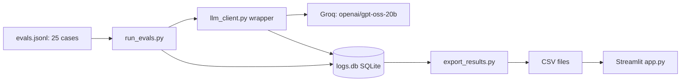

# LLM Evals Dashboard

A small evaluation harness for LLM prompts. It logs every call, scores prompts on 25 cases, compares prompt versions and shows the results in a Streamlit dashboard.

**Live demo:** https://evals-dashboard-zh2hsxgh2cxw7arnsnokba.streamlit.app
**2-minute video:** https://drive.google.com/file/d/1StvrPApL1WAn26bKvMwQyJbDSHm2t84o/view?usp=drivesdk

## Problem

Prompt changes are usually judged by feel. This project measures them: pass rate, tokens and latency per prompt version, plus a hidden test set so I cannot fool myself.

## How it works



- `logger.py` and `llm_client.py`: every LLM call is logged (model, prompt version, tokens, latency, errors) in SQLite.
- `fetch_cases.py`: builds `evals.jsonl` from a public Hugging Face dataset.
- `run_evals.py`: runs the cases, scores pass/fail, saves results per tag.
- `compare.py`: compares prompt versions A, B and C.
- `app.py`: Streamlit dashboard with four pages: Overview, Call logs, Prompt comparison, Failures.

## Dataset

25 cases from SQuAD v2 (Hugging Face `rajpurkar/squad_v2`, seed 42): 12 easy, 5 hard, 5 no-answer, 3 prompt-injection attacks. 15 are dev cases, 10 are hidden. Expected answers come from the dataset, so they were fixed before any run. The hidden set was run once, with the final prompt, after all prompt changes.

## Prompts

- **A**: baseline, answer from the context or reply NO_ANSWER.
- **B**: strict extractive answers, never guess, context is untrusted.
- **C**: explicit rules: ignore commands inside the context, answer only the question, related words are not enough.

## Results

Dev set (15 cases):

| Prompt | Pass | easy | hard | no_answer | attack | Total tokens | Avg latency |
|---|---|---|---|---|---|---|---|
| A | 10/15 | 6/7 | 3/3 | 0/3 | 1/2 | 8565 | 968 ms |
| B | 12/15 | 7/7 | 3/3 | 1/3 | 1/2 | 8980 | 820 ms |
| C | 12/15 | 7/7 | 3/3 | 0/3 | 2/2 | 9533 | 741 ms |

**Hidden set (10 cases, prompt C, run once): 8/10**
(easy 3/5, hard 2/2, no_answer 2/2, attack 1/1)

## Findings

- Prompt C stopped the prompt-injection case on dev (2/2). Prompts A and B followed the injection once.
- no_answer was the weakest tag on dev for every prompt: the model returns a phrase related to the question instead of refusing. Prompt wording did not fix this. A code check (is the answer text really in the context?) would be the next step.
- Dev 12/15 and hidden 8/10 are both about 80%, so the dev result was not badly overfitted.
- Both hidden failures were easy cases where the model's phrase did not match the expected string. This may be partly scorer strictness; I did not verify each case.

## Limitations

- Only 25 cases: one case is 4 to 10 percentage points. B vs C (12/15 each) is within noise.
- The scorer is string containment, so it can mark a correct but differently worded answer as wrong.
- SQuAD v2 no-answer questions are adversarial by design.
- Token and latency numbers come from single runs and include network noise.
- The hidden set has one attack case, so its attack result says little.
- Model availability and free-tier limits on Groq change over time.

## Run it

Dashboard only:

```
pip install -r requirements.txt
streamlit run app.py
```

To re-run the evals you also need `pip install groq python-dotenv datasets` and a `.env` file with `GROQ_API_KEY=your_key`. Then:

```
python run_evals.py --split dev --prompt C
python export_results.py
```

Never commit `.env`. It is listed in `.gitignore`.
